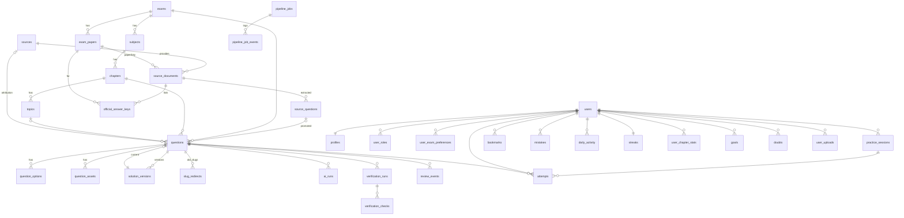

# ProjectX — Database Schema (binding)

Target: Supabase Postgres 15+ and PGlite (PG 18) — PG ≤15 SQL only. All tables in `public`; internal functions in
`app_private`. Conventions:
* PK `id uuid primary key default gen_random_uuid()` unless stated. FKs `on delete restrict` unless stated.
* `created_at timestamptz not null default now()`, `updated_at timestamptz not null default now()` maintained by
  trigger `app_private.set_updated_at()` (BEFORE UPDATE) on every table that has `updated_at`.
* Slug pattern check name `*_slug_format`: `slug ~ '^[a-z0-9]+(-[a-z0-9]+)*$'`. Same for `segment`.
* Enum values UPPER_SNAKE; identical strings in Zod (`packages/contracts/src/enums.ts`) and Python.
* `jsonb` columns that hold arrays have `check (jsonb_typeof(col) = 'array')`.
* "user_id" columns reference `auth.users(id) on delete cascade` unless stated.

## 0. Migration files (apply in this order)

| File | Contents |
|---|---|
| `supabase/migrations/0001_extensions_helpers.sql` | `create schema if not exists app_private`; `create extension if not exists pg_trgm with schema extensions`; `set_updated_at()`, `slugify()`, `strip_latex()`, `append_only()` |
| `0002_enums.sql` | all enum types §1 |
| `0003_taxonomy.sql` | exams, subjects, chapters, topics |
| `0004_provenance.sql` | sources, exam_papers, source_documents |
| `0005_questions.sql` | questions, question_options, question_assets, slug_redirects + question triggers (no FKs to later tables yet) |
| `0006_solutions.sql` | solution_versions + triggers; `alter table questions add constraint questions_current_solution_fk …` |
| `0007_pipeline.sql` | pipeline_jobs, pipeline_job_events, source_questions, official_answer_keys, job functions, promote/link/dedupe functions; FK `questions.source_question_id` |
| `0008_verification.sql` | ai_runs, verification_runs, verification_checks, review_events, audit_log, usage_counters; FK `solution_versions.ai_run_id` |
| `0009_users.sql` | user_roles, profiles, user_exam_preferences, `handle_new_user` trigger on `auth.users`, `is_staff()` |
| `0010_practice.sql` | practice_sessions, attempts, bookmarks, mistakes, daily_activity, streaks, user_chapter_stats, goals + attempt triggers + streak functions |
| `0011_doubts_uploads.sql` | user_uploads, doubts |
| `0012_rls_and_grants.sql` | enable RLS everywhere, policies, revokes/grants, function EXECUTE grants |
| `0013_publication_guard.sql` | `questions_publication_guard` trigger (needs solutions/keys tables) |
| `0014_publication_guard_hardening.sql` | Guard runs on every write to a PUBLISHED row; deferred re-checks when solutions/options change; NUMERICAL keys compared semantically; `attempts.session_id` must belong to the same user |
| `0015_profile_class_level_session_ui.sql` | Profile class level (onboarding); practice session `ui_mode` and time limit |
| `0016_pin_helper_search_path.sql` | Pins `search_path` on internal helper functions |
| `0017_shared_rate_limits.sql` | Shared (cross-instance) rate-limit counters in `app_private.rate_limit_windows` |
| `0018_billing.sql` | Tabby Plus billing: Razorpay one-time orders, passes, promo codes, free full-paper allowance (`billing_*` tables, written by the API only) |
| `0019_analytics.sql` | Privacy-light aggregate daily counters (`analytics_daily`); no user, IP, device or free text |
| `0020_publish_ai_checked.sql` | AI-generated practice questions may publish once automated checks pass (practice-only, not indexed) |
| `0021_ai_checked_practice_only.sql` | Publication guard enforces the practice-only rule for `AI_GENERATED` questions |
| `0022_problem_families.sql` | Problem set: questions that differ only in numbers share a numbered problem; live counters and per-user status |
| `0023_problem_title_cleanup.sql` | Cleaner problem titles (LaTeX spacing and escaped symbols removed) |
| `0024_study_plans.sql` | Study plans (Tabby Plus), built from a diagnostic session |
| `0025_link_keys_clears_stale_official.sql` | Re-linking official keys clears a stale OFFICIAL answer when the key is dropped or cannot be mapped |
| `0026_classification_rewards_billing_fixes.sql` | Question difficulty metadata, rewarded-ad tables, `billing_orders.refunded_paise`. Additive only. Applied to the live database 2026-11-20. |
| `0027_official_pyq_without_ai.sql` | Publish guard allows a null `difficulty` only for `OFFICIAL_KEY_MATCHED` questions (official-key PYQs published without AI). PYQs do not join problem families. `questions.difficulty_source` accepts `'STATS'` (set by the `rate-difficulty` job). Applied to the live database 2026-11-20. |

Seeds (`supabase/seed/`, idempotent `insert … on conflict (slug) do update`): `0001_exams.sql`, `0002_subjects.sql`,
`0003_chapters_jee_main.sql`, `0004_topics_jee_main.sql`, `0005_sources.sql`. Dev-only fixtures (never prod):
`supabase/fixtures/0001_dev_demo_content.sql`. Test-only shim: `supabase/shim/00_supabase_shim.sql`.
`supabase/config.toml`: `[db.seed] enabled = true, sql_paths = ["./seed/*.sql"]`. The 4-digit file names are accepted by the Supabase CLI (see DEPLOY_FACTS.md §1.2).

### 0a. Tables added after 0013

| Table | Migration | Purpose |
|---|---|---|
| `app_private.rate_limit_windows` | 0017 | Shared rate-limit counters. Internal; no client access |
| `billing_plans`, `billing_payment_links`, `billing_orders`, `billing_events`, `billing_entitlements`, `billing_promo_codes`, `billing_promo_redemptions`, `billing_full_paper_usage` | 0018 | Tabby Plus prices, payment links, Razorpay orders and webhook events, access passes, promo codes, free full-paper allowance. No client grants |
| `analytics_daily` | 0019 | Aggregate daily event counters |
| `question_families`, `user_family_status` | 0022 | Problem families (numbered problems) and each student's status per problem. Adds `questions.family_id` |
| `study_plans` | 0024 | One study plan per user and exam; days stored as jsonb |
| `ad_reward_rules`, `ad_reward_claims` | 0026 | Rewarded-ad rules and claims. Also adds `questions.difficulty_source`, `difficulty_set_by`, `difficulty_set_at` and `billing_orders.refunded_paise` |

## 1. Enums (0002)

```sql
create type question_type          as enum ('SINGLE_MCQ','MULTI_MCQ','NUMERICAL');
create type marking_scheme         as enum ('STANDARD','PARTIAL_MULTI');
create type difficulty             as enum ('EASY','MEDIUM','HARD');
create type question_origin        as enum ('PYQ','AI_GENERATED','EDITORIAL');
create type verification_status    as enum ('PENDING','AUTOMATED_CHECKS_PASSED','OFFICIAL_KEY_MATCHED','HUMAN_REVIEW_REQUIRED','HUMAN_VERIFIED','DISPUTED');
create type publication_status     as enum ('DRAFT','PUBLISHED','ARCHIVED');
create type ingestion_status       as enum ('IMPORTED','CLASSIFIED','SOLVED','CHECKED','NEEDS_ATTENTION');
create type indexability           as enum ('AUTO','NOINDEX');
create type access_tier            as enum ('FREE','PREMIUM');
create type answer_key_source      as enum ('OFFICIAL','HUMAN','AI_CONSENSUS');
create type source_kind            as enum ('OFFICIAL_EXAM_BODY','LICENSED_PUBLISHER','EDITORIAL_TEAM','AI_GENERATION');
create type source_document_kind   as enum ('QUESTION_PAPER','ANSWER_KEY','OTHER');
create type storage_bucket         as enum ('SOURCE_DOCS','PUBLIC_ASSETS','USER_UPLOADS');
create type asset_kind             as enum ('IMAGE','DIAGRAM','TABLE_IMAGE','ORIGINAL_CROP');
create type source_question_status as enum ('EXTRACTED','NORMALIZED','DUPLICATE','PROMOTED','REJECTED');
create type job_kind               as enum ('PROCESS_DOCUMENT','PARSE_ANSWER_KEY','AI_CLASSIFY','AI_SOLVE','AI_VERIFY','AI_SEO');
create type job_status             as enum ('QUEUED','RUNNING','SUCCEEDED','DEAD','CANCELLED');
create type job_event_level        as enum ('DEBUG','INFO','WARN','ERROR');
create type ai_task                as enum ('CLASSIFY','ANSWER','SOLVE','ALTERNATIVES','CRITIQUE','QUALITY','SEO_META');
create type ai_run_status          as enum ('SUCCEEDED','FAILED','SCHEMA_INVALID','BLOCKED');
create type solution_provenance    as enum ('AI_GENERATED','AI_HUMAN_EDITED','HUMAN_AUTHORED','OFFICIAL');
create type solution_review_status as enum ('PENDING','APPROVED','REJECTED','SUPERSEDED');
create type verification_outcome   as enum ('PASSED','NEEDS_REVIEW','FAILED');
create type check_kind             as enum ('OFFICIAL_KEY_MATCH','INDEPENDENT_ANSWER_AGREEMENT','SYMPY_CHECK','AI_CRITIQUE','CONTENT_COMPLETENESS','CLASSIFICATION_CONFIDENCE');
create type check_result           as enum ('PASS','FAIL','INCONCLUSIVE','SKIPPED','ERROR');
create type review_action          as enum ('APPROVE','REJECT_SOLUTION','REJECT_QUESTION','EDIT_CONTENT','EDIT_SOLUTION','PUBLISH','UNPUBLISH','ARCHIVE','RESTORE','MARK_DISPUTED','RESOLVE_DISPUTE','SET_INDEXABILITY','REQUEST_REVERIFY');
create type app_role               as enum ('ADMIN','REVIEWER');
create type practice_mode          as enum ('SUBJECT','CHAPTER','TOPIC','MIXED','PYQ_PAPER','MISTAKES','BOOKMARKS');
create type session_status         as enum ('ACTIVE','COMPLETED','ABANDONED');
create type goal_kind              as enum ('DAILY_ATTEMPTS','WEEKLY_ATTEMPTS','CHAPTER_ACCURACY');
create type doubt_status           as enum ('OPEN','ANSWERED','CLOSED','SPAM');
create type upload_purpose         as enum ('DOUBT_ATTACHMENT');
create type upload_status          as enum ('CONFIRMED','REJECTED','DELETED');
```
Future (not now, `ALTER TYPE … ADD VALUE`): question_type `MATRIX_MATCH`, `INTEGER`; practice_mode `MOCK_TEST`.

## 2. JSON shapes stored in jsonb (validated in app via Zod; DB checks only array/object type)

* `ContentBlock[]` — see API_CONTRACTS.md §2.2 (`paragraph|math|image|table|list`). Images reference `question_assets.id`.
* `AnswerKey` (questions.answer_key, solution_versions.final_answer):
  `{"type":"SINGLE_MCQ","correct_option_ids":[uuid,…≥1]}` (any one = correct; >1 only for officially accepted multiple)
  `{"type":"MULTI_MCQ","correct_option_ids":[uuid,…≥1]}` (exact set)
  `{"type":"NUMERICAL","accepted_ranges":[{"min":"2.48","max":"2.52"},…≥1],"display_value":"2.5"}` (decimal strings `^-?\d+(\.\d+)?$`)
* `OfficialAnswer` (official_answer_keys.normalized_answer):
  `{"kind":"OPTION_LABELS","labels":["B"]}` | `{"kind":"EXTERNAL_OPTION_IDS","ids":["..."]}` | `{"kind":"NUMERIC","accepted_ranges":[{min,max}]}` | `{"kind":"DROPPED"}`
* `AnswerResponse` (attempts.response): `{"type":"SINGLE_MCQ","option_id":uuid}` | `{"type":"MULTI_MCQ","option_ids":[uuid…]}` | `{"type":"NUMERICAL","value":"decimal"}`
* `SolutionStep[]`: `[{"index":1,"title":string|null,"blocks":ContentBlock[]}]`; `formulas`: `[{"name":string,"latex":string}]`;
  `alternatives`: `[{"title":string,"steps":SolutionStep[]}]`; `shortcuts`, `common_mistakes`: `string[]` (inline-LaTeX text).

## 3. Tables

### 0001 helpers
```sql
app_private.set_updated_at() returns trigger                -- new.updated_at := now()
app_private.slugify(t text) returns text immutable          -- lower; strip_latex; [^a-z0-9]+ → '-'; trim '-'; left(…,80) trimmed at '-'
app_private.strip_latex(t text) returns text immutable      -- remove '$', '\cmd', '{','}','^','_' → spaces; collapse ws
app_private.append_only() returns trigger                   -- raise exception 'append-only table' (SQLSTATE 'P0001') on UPDATE/DELETE
```

### 0003 taxonomy
```sql
exams(id, code text not null unique check (code ~ '^[A-Z][A-Z0-9_]*$'), slug text not null unique /*'jee-main'*/,
  name text not null, short_name text not null, description text, is_active boolean not null default false,
  sort_order int not null default 0, created_at, updated_at)
subjects(id, exam_id uuid not null references exams, code text not null check (code in ('PHYSICS','CHEMISTRY','MATHEMATICS','BIOLOGY','BOTANY','ZOOLOGY')),
  slug text not null unique /*'jee-main-physics'*/, segment text not null /*'physics'*/, name text not null,
  is_active boolean not null default true, sort_order int not null default 0, created_at, updated_at,
  unique (exam_id, code), unique (exam_id, segment))
chapters(id, subject_id uuid not null references subjects, slug text not null unique /*'jee-main-physics-kinematics'*/,
  segment text not null /*'kinematics'*/, name text not null, unit_number smallint, class_level smallint check (class_level in (11,12)),
  description text, is_active boolean not null default true, sort_order int not null default 0, created_at, updated_at,
  unique (subject_id, segment))
topics(id, chapter_id uuid not null references chapters, slug text not null unique /*chapter.slug||'-'||segment*/,
  segment text not null, name text not null, is_active boolean not null default true, sort_order int not null default 0,
  created_at, updated_at, unique (chapter_id, segment))
-- indexes: subjects(exam_id, sort_order); chapters(subject_id, sort_order); topics(chapter_id, sort_order)
```

### 0004 provenance
```sql
sources(id, code text not null unique check (code ~ '^[A-Z][A-Z0-9_]*$') /*'NTA'*/, name text not null, kind source_kind not null,
  publisher text, homepage_url text, license_name text, license_url text,
  reuse_permitted boolean not null default false, attribution_text text,
  approved_by uuid references auth.users on delete set null, approved_at timestamptz, notes text, created_at, updated_at,
  constraint sources_approval_requires_reuse check (approved_at is null or reuse_permitted))
exam_papers(id, exam_id uuid not null references exams, slug text not null unique /*'jee-main-2024-jan-27-shift-1'*/,
  title text not null, year smallint not null check (year between 1978 and 2100), session_label text /*'January'*/,
  exam_date date, shift smallint check (shift between 1 and 4), paper_code text, language text not null default 'en',
  created_at, updated_at, unique nulls not distinct (exam_id, exam_date, shift, paper_code, language))
source_documents(id, source_id uuid not null references sources, paper_id uuid references exam_papers,
  kind source_document_kind not null, bucket storage_bucket not null default 'SOURCE_DOCS' check (bucket='SOURCE_DOCS'),
  r2_key text not null unique, original_filename text not null, mime_type text not null check (mime_type in ('application/pdf','text/html','image/png','image/jpeg')),
  bytes bigint not null check (bytes > 0), sha256 text not null unique check (sha256 ~ '^[0-9a-f]{64}$'), page_count int,
  uploaded_by uuid references auth.users on delete set null, created_at)
-- trigger source_documents_require_approved_source BEFORE INSERT: source must have reuse_permitted and approved_at not null else raise 'SOURCE_NOT_APPROVED'
```

### 0005 questions
```sql
questions(
  id uuid pk, slug text not null unique check (slug format, length(slug) <= 120),
  exam_id uuid not null references exams, subject_id uuid references subjects, chapter_id uuid references chapters,
  topic_id uuid references topics, paper_id uuid references exam_papers,
  origin question_origin not null, question_type question_type not null,
  marking_scheme marking_scheme not null default 'STANDARD', difficulty difficulty,
  marks numeric(5,2) not null default 4 check (marks > 0), negative_marks numeric(5,2) not null default 1 check (negative_marks >= 0),
  year smallint check (year between 1978 and 2100), shift smallint check (shift between 1 and 4), session_label text,
  question_number text,
  question_text text not null check (length(question_text) between 1 and 20000),   -- plain text + inline LaTeX; derived from structured_content by writer
  structured_content jsonb not null check (jsonb_typeof(structured_content)='array'),
  answer_key jsonb check (answer_key is null or jsonb_typeof(answer_key)='object'),
  answer_key_source answer_key_source,
  source_id uuid references sources, source_question_id uuid unique /*FK added in 0007*/,
  content_hash text, dedupe_text text,
  ingestion_status ingestion_status not null default 'IMPORTED',
  verification_status verification_status not null default 'PENDING',
  publication_status publication_status not null default 'DRAFT',
  indexability indexability not null default 'AUTO', sitemap_include boolean not null default false,
  access_tier access_tier not null default 'FREE',
  current_solution_id uuid /*FK added in 0006*/,
  seo_title text check (length(seo_title) <= 70), seo_description text check (length(seo_description) <= 170),
  search_tsv tsvector,
  is_indexable boolean generated always as (
     publication_status = 'PUBLISHED' and indexability = 'AUTO'
     and verification_status in ('OFFICIAL_KEY_MATCHED','HUMAN_VERIFIED') and current_solution_id is not null) stored,
  row_version int not null default 1,
  created_by uuid references auth.users on delete set null,
  created_at, updated_at, published_at timestamptz, first_published_at timestamptz, archived_at timestamptz,
  constraint questions_pyq_requires_source check (origin <> 'PYQ' or source_id is not null),
  constraint questions_answer_key_source_pair check ((answer_key is null) = (answer_key_source is null))
)
question_options(id, question_id uuid not null references questions on delete cascade,
  label text not null check (label in ('A','B','C','D','E')), sort_order smallint not null check (sort_order between 0 and 9),
  content jsonb not null check (jsonb_typeof(content)='array'), content_text text not null, external_option_id text,
  created_at, updated_at, unique (question_id, label), unique (question_id, sort_order))
question_assets(id, question_id uuid references questions on delete cascade, solution_version_id uuid /*FK 0006, cascade*/,
  source_question_id uuid /*FK 0007, set null*/, kind asset_kind not null,
  bucket storage_bucket not null check (bucket in ('SOURCE_DOCS','PUBLIC_ASSETS')), r2_key text not null,
  mime_type text not null check (mime_type in ('image/png','image/jpeg','image/webp')),
  width int check (width > 0), height int check (height > 0), bytes int check (bytes > 0),
  sha256 text not null check (sha256 ~ '^[0-9a-f]{64}$'), alt_text text, created_at,
  unique (bucket, r2_key),
  constraint question_assets_owner check (num_nonnulls(question_id, solution_version_id, source_question_id) >= 1))
slug_redirects(old_slug text primary key check (slug format), question_id uuid not null references questions on delete cascade, created_at)
```
Indexes: `questions(chapter_id, publication_status, difficulty)`, `questions(subject_id, publication_status)`,
`questions(topic_id) where topic_id is not null`, `questions(paper_id, question_number)`,
`questions(verification_status, updated_at desc)`, `questions(publication_status, published_at desc)`,
`questions(is_indexable, sitemap_include, updated_at) where is_indexable and sitemap_include`,
`questions using gin (search_tsv)`, `questions using gin (dedupe_text extensions.gin_trgm_ops)`,
`questions(content_hash)`, `question_options(question_id)`, `question_assets(question_id)`, `question_assets(sha256)`.

Triggers on `questions` (functions in `app_private`, `security definer set search_path = ''`):
* `questions_before_write` BEFORE INSERT OR UPDATE:
  1. **Slug**: on INSERT if `slug` null → `base := slugify(first 12 words of question_text)`; if `year` not null and
     exam known → `base || '-' || exam.slug || '-' || year`; empty → `'question'`. Candidate `base`, then `base-2`,
     `base-3`… until absent from `questions.slug` and `slug_redirects.old_slug`. Slug change on UPDATE when
     `old.first_published_at is not null` is allowed only if `current_setting('app.allow_slug_change', true) = 'on'`
     (API sets it in the admin txn), else raise `SLUG_LOCKED`.
  2. **Taxonomy consistency**: subject.exam_id = exam_id; chapter.subject_id = subject_id; topic.chapter_id = chapter_id
     (raise `TAXONOMY_MISMATCH`). If chapter set and subject null → fill subject.
  3. **FTS**: `search_tsv := setweight(to_tsvector('english', coalesce(seo_title,'')),'A') || setweight(to_tsvector('english', strip_latex(question_text)),'B')`.
  4. **row_version** := old.row_version + 1 on UPDATE.
  5. **publication timestamps**: entering PUBLISHED → `published_at = now()`, `first_published_at = coalesce(first_published_at, now())`;
     entering ARCHIVED → `archived_at = now()`; leaving PUBLISHED → `published_at = null`.
* `questions_after_slug_change` AFTER UPDATE OF slug: `insert into slug_redirects(old_slug, question_id) values (old.slug, new.id) on conflict (old_slug) do update set question_id = excluded.question_id`; delete any redirect whose old_slug = new.slug.
* `questions_publication_guard` (0013) BEFORE UPDATE OF publication_status, verification_status, current_solution_id, answer_key
  when `new.publication_status='PUBLISHED'` — all must hold else raise `PUBLISH_REQUIREMENTS_NOT_MET: <reason>`:
  verification_status in ('OFFICIAL_KEY_MATCHED','HUMAN_VERIFIED'); current_solution_id not null and that version
  belongs to this question with `review_status='APPROVED'`; answer_key not null and `answer_key = final_answer` of current
  solution (jsonb equality after app canonicalisation); subject_id, chapter_id not null, difficulty not null (except `OFFICIAL_KEY_MATCHED` PYQs, 0027); MCQ types have ≥2 options
  and every `correct_option_ids` element is an option of this question; NUMERICAL has 0 options.
  DISPUTED while PUBLISHED → trigger forces `publication_status='DRAFT'` (auto-unpublish; API purges cache).

### 0006 solutions
```sql
solution_versions(id, question_id uuid not null references questions on delete cascade, version int not null,
  final_answer jsonb not null, summary text check (length(summary) <= 2000),
  steps jsonb not null check (jsonb_typeof(steps)='array'), formulas jsonb not null default '[]', concepts text[] not null default '{}',
  alternatives jsonb not null default '[]', shortcuts jsonb not null default '[]', common_mistakes jsonb not null default '[]',
  sympy_checks jsonb not null default '[]',      -- SympyCheckRequest[] proposed by the solver (AI_PIPELINE §4)
  provenance solution_provenance not null, ai_run_id uuid /*FK 0008 set null*/,
  based_on_version_id uuid references solution_versions on delete set null,
  author_id uuid references auth.users on delete set null, edit_note text,
  review_status solution_review_status not null default 'PENDING',
  reviewed_by uuid references auth.users on delete set null, reviewed_at timestamptz,
  created_at, unique (question_id, version))
alter table questions add constraint questions_current_solution_fk foreign key (current_solution_id) references solution_versions(id) on delete set null deferrable initially deferred;
```
Triggers: `solution_versions_assign_version` BEFORE INSERT: lock parent (`select 1 from questions where id=new.question_id for update`),
`new.version := coalesce(max(version),0)+1`. `solution_versions_immutable` BEFORE UPDATE: raise `SOLUTION_IMMUTABLE` if any column
other than `review_status, reviewed_by, reviewed_at` differs; BEFORE DELETE: raise unless parent question is being deleted
(allow when `pg_trigger_depth() > 1`). When a version becomes APPROVED and is set as current, the API sets previous APPROVED
versions of that question to `SUPERSEDED` (same txn). Index `solution_versions(question_id, version desc)`.

### 0007 pipeline
```sql
pipeline_jobs(id, kind job_kind not null, idempotency_key text not null unique, status job_status not null default 'QUEUED',
  priority int not null default 100 /*lower = sooner*/, payload jsonb not null default '{}', result jsonb,
  attempts int not null default 0, max_attempts int not null default 5 check (max_attempts between 1 and 20),
  run_after timestamptz not null default now(), locked_by text, locked_at timestamptz, lease_expires_at timestamptz,
  last_error text, source_document_id uuid references source_documents on delete set null,
  question_id uuid references questions on delete set null,
  created_by uuid references auth.users on delete set null, created_at, updated_at, started_at timestamptz, finished_at timestamptz)
-- index pipeline_jobs(status, kind, priority, run_after) where status in ('QUEUED','RUNNING'); (question_id); (source_document_id)
pipeline_job_events(id bigint generated always as identity primary key, job_id uuid not null references pipeline_jobs on delete cascade,
  level job_event_level not null, stage text, message text not null check (length(message) <= 2000), data jsonb, created_at)
-- index (job_id, id); append_only trigger
source_questions(id, source_document_id uuid not null references source_documents on delete cascade, job_id uuid references pipeline_jobs on delete set null,
  question_number text not null, external_question_id text, page_start int not null, page_end int not null,
  status source_question_status not null default 'EXTRACTED',
  normalized jsonb not null,                 -- NormalizedQuestion (INGESTION_PIPELINE §3)
  normalized_text text not null, content_hash text not null check (content_hash ~ '^[0-9a-f]{64}$'),
  extraction_method text not null check (extraction_method in ('TEXT','OCR','MIXED')), ocr_mean_confidence real,
  warnings text[] not null default '{}', duplicate_of_question_id uuid references questions on delete set null,
  possible_duplicate_of uuid references questions on delete set null, duplicate_similarity real,
  promoted_question_id uuid references questions on delete set null, created_at, updated_at,
  unique (source_document_id, question_number))
-- index source_questions(content_hash); (source_document_id, status); unique (source_document_id, external_question_id) where external_question_id is not null
official_answer_keys(id, source_document_id uuid not null references source_documents on delete cascade,
  paper_id uuid not null references exam_papers, question_number text, external_question_id text,
  raw_answer text not null, normalized_answer jsonb not null, is_dropped boolean not null default false,
  question_id uuid references questions on delete set null, created_at,
  check (question_number is not null or external_question_id is not null),
  unique nulls not distinct (paper_id, question_number, external_question_id))
alter table questions add constraint questions_source_question_fk foreign key (source_question_id) references source_questions(id) on delete set null;
alter table question_assets add constraint question_assets_source_question_fk foreign key (source_question_id) references source_questions(id) on delete set null;
```
Functions (`app_private`, security definer, `search_path=''`, EXECUTE revoked from public; called by owner connection):
```sql
enqueue_pipeline_job(p_kind job_kind, p_idempotency_key text, p_payload jsonb default '{}', p_priority int default 100,
  p_run_after timestamptz default now(), p_question_id uuid default null, p_source_document_id uuid default null,
  p_created_by uuid default null) returns uuid
  -- insert … on conflict (idempotency_key) do nothing; return id of new or existing row
claim_pipeline_job(p_worker_id text, p_kinds job_kind[], p_lease_seconds int default 600) returns setof pipeline_jobs
  -- picks 1 row: (status='QUEUED' and run_after<=now()) or (status='RUNNING' and lease_expires_at<now());
  -- order by priority, run_after, created_at; FOR UPDATE SKIP LOCKED; sets RUNNING, attempts+1, locked_by, locked_at,
  -- lease_expires_at=now()+lease, started_at=coalesce(started_at,now()); if attempts would exceed max_attempts → set DEAD, try next.
heartbeat_pipeline_job(p_job_id uuid, p_worker_id text, p_lease_seconds int default 600) returns boolean  -- false if not owner
complete_pipeline_job(p_job_id uuid, p_worker_id text, p_result jsonb) returns boolean                    -- RUNNING+owner → SUCCEEDED
fail_pipeline_job(p_job_id uuid, p_worker_id text, p_error text, p_retryable boolean default true) returns job_status
  -- retryable and attempts<max → QUEUED, run_after=now()+least(3600, 30*2^(attempts-1)) s; else DEAD; last_error=left(p_error,4000)
log_pipeline_job_event(p_job_id uuid, p_level job_event_level, p_stage text, p_message text, p_data jsonb default null) returns void
find_near_duplicates(p_text text, p_threshold real default 0.9, p_limit int default 5) returns table(question_id uuid, similarity real)
  -- extensions.similarity(dedupe_text, p_text) >= p_threshold on questions, ordered desc
promote_source_question(p_source_question_id uuid, p_exam_id uuid, p_subject_code text default null) returns uuid
  -- requires status='NORMALIZED' and duplicate_of_question_id is null; creates questions row (origin from source.kind:
  -- OFFICIAL_EXAM_BODY|LICENSED_PUBLISHER→PYQ, EDITORIAL_TEAM→EDITORIAL, AI_GENERATION→AI_GENERATED), paper/year/shift/
  -- session from exam_papers, structured_content/options from normalized (asset_ref → normalized.assets[].asset_id, rows already
  -- created by the worker for this source_question; sets question_assets.question_id), question_text = normalized->>'question_text',
  -- question_type = coalesce(question_type_guess, options empty ? 'NUMERICAL' : 'SINGLE_MCQ'), subject from p_subject_code or section_hint,
  -- content_hash, dedupe_text = normalized_text, external_option_id copied to question_options;
  -- marks it PROMOTED; calls link for its key; enqueues AI_CLASSIFY with key 'AI_CLASSIFY:'||qid||':'||content_hash. Idempotent:
  -- if already PROMOTED returns promoted_question_id.
link_official_answer_keys(p_paper_id uuid) returns int
  -- match official_answer_keys ↔ questions of that paper by external_question_id, else question_number; convert OfficialAnswer
  -- to AnswerKey (labels/external ids → option ids); set questions.answer_key + answer_key_source='OFFICIAL' unless current
  -- answer_key_source='HUMAN'; DROPPED → set verification_status='HUMAN_REVIEW_REQUIRED' (no key). Returns rows updated.
```

### 0008 verification & audit
```sql
ai_runs(id, task ai_task not null, question_id uuid references questions on delete cascade, solution_version_id uuid references solution_versions on delete set null,
  job_id uuid references pipeline_jobs on delete set null, provider text not null check (provider in ('gemini','mock')), model text not null,
  prompt_id text not null, prompt_version text not null, input_hash text not null check (input_hash ~ '^[0-9a-f]{64}$'),
  status ai_run_status not null, output jsonb, error text, input_tokens int, output_tokens int,
  cost_usd_micros bigint not null default 0, latency_ms int, created_at)
-- unique (task, input_hash) where status='SUCCEEDED'  (cache/idempotency); index (question_id, task, created_at desc); index (created_at)
alter table solution_versions add constraint solution_versions_ai_run_fk foreign key (ai_run_id) references ai_runs(id) on delete set null;
verification_runs(id, question_id uuid not null references questions on delete cascade, solution_version_id uuid references solution_versions on delete set null,
  job_id uuid references pipeline_jobs on delete set null, rules_version text not null, outcome verification_outcome,
  resulting_status verification_status, reasons text[] not null default '{}', started_at timestamptz not null default now(), finished_at timestamptz)
-- index (question_id, started_at desc)
verification_checks(id, verification_run_id uuid not null references verification_runs on delete cascade, kind check_kind not null,
  result check_result not null, details jsonb not null default '{}', ai_run_id uuid references ai_runs on delete set null, created_at,
  unique (verification_run_id, kind))
review_events(id bigint generated always as identity primary key, question_id uuid not null references questions on delete cascade,
  solution_version_id uuid references solution_versions on delete set null, actor_id uuid references auth.users on delete set null,
  action review_action not null, from_verification_status verification_status, to_verification_status verification_status,
  from_publication_status publication_status, to_publication_status publication_status, note text check (length(note) <= 4000), created_at)
-- index (question_id, id desc); append_only trigger (UPDATE/DELETE raise; cascade from question deletion allowed via pg_trigger_depth()>1)
audit_log(id bigint generated always as identity primary key, actor_id uuid, actor_type text not null check (actor_type in ('USER','ADMIN','SYSTEM','WORKER')),
  action text not null, entity_type text not null, entity_id uuid, request_id text, ip_hash text, details jsonb, created_at)
-- index (entity_type, entity_id, id desc), (created_at); append_only trigger
usage_counters(day date not null, metric text not null check (metric ~ '^[a-z0-9_.]+$'), value bigint not null default 0,
  updated_at, primary key (day, metric))     -- e.g. ai.cost_usd_micros, ai.calls, ingestion.pages, api.attempts
```

### 0009 users
```sql
user_roles(user_id uuid not null references auth.users on delete cascade, role app_role not null,
  granted_by uuid references auth.users on delete set null, created_at, primary key (user_id, role))
profiles(id uuid primary key references auth.users on delete cascade, display_name text check (length(display_name) <= 60),
  timezone text not null default 'Asia/Kolkata', target_exam_id uuid references exams on delete set null,
  target_year smallint check (target_year between 2020 and 2100),
  daily_goal_attempts smallint not null default 10 check (daily_goal_attempts between 1 and 500),
  onboarding_completed_at timestamptz, created_at, updated_at)
-- trigger profiles_validate_timezone BEFORE INSERT OR UPDATE OF timezone: must exist in pg_timezone_names else raise 'INVALID_TIMEZONE'
user_exam_preferences(user_id uuid not null references auth.users on delete cascade, exam_id uuid not null references exams,
  is_primary boolean not null default false, target_year smallint, created_at, updated_at, primary key (user_id, exam_id))
-- unique (user_id) where is_primary
app_private.handle_new_user() -- AFTER INSERT ON auth.users: insert profiles(id, display_name = raw_user_meta_data->>'display_name' truncated 60,
  --   timezone = raw_user_meta_data->>'timezone' if valid else default) and streaks(user_id) on conflict do nothing
app_private.is_staff(p_user uuid, p_role app_role default null) returns boolean stable
app_private.is_published_question(p_question uuid) returns boolean stable   -- granted to authenticated (used in bookmarks policy)
```

### 0010 practice
```sql
practice_sessions(id, user_id uuid not null references auth.users on delete cascade, client_request_id uuid not null,
  mode practice_mode not null, exam_id uuid not null references exams, subject_id uuid references subjects, chapter_id uuid references chapters,
  topic_id uuid references topics, paper_id uuid references exam_papers, filters jsonb not null default '{}',
  question_ids uuid[] not null check (cardinality(question_ids) between 1 and 50),
  status session_status not null default 'ACTIVE', attempted_count int not null default 0, correct_count int not null default 0,
  score numeric(7,2) not null default 0, started_at timestamptz not null default now(), completed_at timestamptz,
  last_activity_at timestamptz not null default now(), created_at, updated_at, unique (user_id, client_request_id))
-- index (user_id, started_at desc)
attempts(id, user_id uuid not null references auth.users on delete cascade, question_id uuid not null references questions,
  session_id uuid references practice_sessions on delete cascade, client_attempt_id uuid not null,
  request_hash text not null check (request_hash ~ '^[0-9a-f]{64}$'), response jsonb not null,
  is_correct boolean not null, score numeric(5,2) not null, time_spent_ms int check (time_spent_ms between 0 and 10800000),
  exam_id uuid not null, subject_id uuid not null, chapter_id uuid not null, topic_id uuid,   -- snapshot, filled by trigger
  activity_date date not null,                                                               -- filled by trigger (user tz)
  submitted_at timestamptz not null default now(), created_at,
  unique (user_id, client_attempt_id))
-- unique (session_id, question_id) where session_id is not null
-- index (user_id, submitted_at desc), (user_id, question_id, submitted_at desc), (user_id, chapter_id), (question_id)
bookmarks(user_id uuid not null references auth.users on delete cascade, question_id uuid not null references questions on delete cascade,
  note text check (length(note) <= 500), created_at, primary key (user_id, question_id))   -- index (user_id, created_at desc)
mistakes(user_id uuid not null references auth.users on delete cascade, question_id uuid not null references questions on delete cascade,
  subject_id uuid not null, chapter_id uuid not null, wrong_count int not null default 1, first_wrong_at timestamptz not null,
  last_wrong_at timestamptz not null, last_attempt_id uuid references attempts on delete set null, resolved_at timestamptz,
  created_at, updated_at, primary key (user_id, question_id))   -- index (user_id, resolved_at, last_wrong_at desc)
daily_activity(user_id uuid not null references auth.users on delete cascade, activity_date date not null,
  attempts_count int not null default 0, correct_count int not null default 0, total_time_ms bigint not null default 0,
  first_attempt_at timestamptz not null, last_attempt_at timestamptz not null, primary key (user_id, activity_date))
streaks(user_id uuid primary key references auth.users on delete cascade, current_streak int not null default 0,
  longest_streak int not null default 0, last_active_date date, updated_at)
user_chapter_stats(user_id uuid not null references auth.users on delete cascade, chapter_id uuid not null references chapters,
  subject_id uuid not null, exam_id uuid not null, attempts_count int not null default 0, correct_count int not null default 0,
  total_time_ms bigint not null default 0, last_attempt_at timestamptz not null, primary key (user_id, chapter_id))
goals(id, user_id uuid not null references auth.users on delete cascade, kind goal_kind not null,
  target_value int not null check (target_value > 0), chapter_id uuid references chapters, is_active boolean not null default true,
  starts_on date not null default current_date, ends_on date, created_at, updated_at,
  check (kind <> 'CHAPTER_ACCURACY' or chapter_id is not null))
```
Triggers (security definer, `search_path=''`):
* `attempts_before_insert`: copy `exam_id, subject_id, chapter_id, topic_id` from the question (raise `QUESTION_NOT_PRACTICABLE`
  if subject/chapter null); `activity_date := (new.submitted_at at time zone coalesce(profile.timezone,'Asia/Kolkata'))::date`.
* `attempts_block_update` BEFORE UPDATE → raise `ATTEMPT_IMMUTABLE` (DELETE allowed only via cascade).
* `attempts_after_insert`:
  1. upsert `daily_activity` (+1 attempts, +correct, +time; first/last_attempt_at).
  2. if the daily_activity row was newly inserted → `app_private.recompute_streak(user_id, activity_date)`.
  3. wrong → upsert `mistakes` (insert wrong_count=1, first/last_wrong_at; on conflict wrong_count+1, last_wrong_at, last_attempt_id,
     resolved_at=null). correct → `update mistakes set resolved_at=now(), last_attempt_id=… where … and resolved_at is null`.
  4. upsert `user_chapter_stats`.
  5. if session_id → `practice_sessions` attempted_count+1, correct_count+?, score+=score, last_activity_at=now(); if
     attempted_count = cardinality(question_ids) → status 'COMPLETED', completed_at=now().
* `app_private.recompute_streak(p_user uuid, p_new_date date)`: let s = streaks row (create if missing).
  `last` null → current=1; `p_new_date = last` → no-op; `p_new_date = last+1` → current+1; `p_new_date > last+1` → current=1;
  `p_new_date < last` (backfill / timezone change) → full recompute: gaps-and-islands over `daily_activity` dates →
  current = length of island ending at max(date), longest = max island length. Always `longest = greatest(longest,current)`,
  `last_active_date = greatest(last, p_new_date)`.
* `app_private.get_streak(p_user uuid) returns table(current_streak int, longest_streak int, last_active_date date, today date)`:
  `today := (now() at time zone tz)::date`; effective current = stored current if `last_active_date >= today-1` else 0.
  (Timezone changes do not rewrite past `activity_date`s.)

### 0011 doubts & uploads
```sql
user_uploads(id, user_id uuid not null references auth.users on delete cascade, purpose upload_purpose not null,
  bucket storage_bucket not null default 'USER_UPLOADS' check (bucket='USER_UPLOADS'), r2_key text not null unique,
  mime_type text not null check (mime_type in ('image/png','image/jpeg','image/webp')), bytes int not null check (bytes between 1 and 5242880),
  sha256 text not null, status upload_status not null default 'CONFIRMED', created_at)   -- index (user_id, created_at desc)
doubts(id, user_id uuid references auth.users on delete set null, question_id uuid references questions on delete set null,
  body text not null check (length(body) between 1 and 4000), upload_id uuid references user_uploads on delete set null,
  status doubt_status not null default 'OPEN', is_public boolean not null default false, ip_hash text,
  created_at, updated_at)   -- index (user_id, created_at desc), (status, created_at), (ip_hash, created_at)
-- trigger doubts_never_auto_public: on INSERT force is_public=false; on UPDATE to true require current_setting('app.actor_role',true)='ADMIN'
```

## 4. RLS & grants (0012)

`alter table … enable row level security` on **every** table above. Then `revoke all on all tables in schema public from anon, authenticated;`
`revoke all on all functions in schema app_private from public;` `revoke usage on schema app_private from anon;`
`grant usage on schema app_private to authenticated; grant execute on function app_private.is_published_question(uuid) to authenticated;`
`service_role` keeps defaults (BYPASSRLS). Then grant exactly:

| Table | anon | authenticated (privileges → policy) |
|---|---|---|
| exams, subjects, chapters, topics | SELECT → `using (is_active)` | SELECT → `using (is_active)` |
| profiles | — | SELECT → `id = (select auth.uid())`; UPDATE(display_name, timezone, target_exam_id, target_year, daily_goal_attempts, onboarding_completed_at) → using/with check same |
| user_exam_preferences | — | SELECT, INSERT, UPDATE, DELETE → `user_id = (select auth.uid())` (using + with check) |
| goals | — | SELECT, INSERT, UPDATE, DELETE → same |
| bookmarks | — | SELECT, DELETE → owner; INSERT → with check owner `and app_private.is_published_question(question_id)`; UPDATE(note) → owner |
| mistakes | — | SELECT, DELETE → owner |
| attempts, practice_sessions, daily_activity, streaks, user_chapter_stats, user_uploads, doubts | — | SELECT → owner (`user_id = (select auth.uid())`) |
| user_roles | — | SELECT → `user_id = (select auth.uid())` |
| all others (questions, question_options, question_assets, slug_redirects, solution_versions, sources, exam_papers, source_documents, source_questions, official_answer_keys, pipeline_jobs, pipeline_job_events, ai_runs, verification_runs, verification_checks, review_events, audit_log, usage_counters) | — | — (RLS on, no policies, no grants) |

Policies are named `<table>_<cmd>_<role>` (e.g. `bookmarks_insert_authenticated`) and always `to authenticated`/`to anon`
(never `public`). Use `(select auth.uid())` (initPlan caching).

Required DB tests (W1, `supabase/tests/*.test.ts`): anon/authenticated denied on every content table incl. `questions.answer_key`;
taxonomy visible to anon only when active; user A cannot read/modify user B rows on every student table; authenticated cannot
INSERT attempts/daily_activity/streaks/mistakes/sessions/doubts; profile column grants (cannot update `id`/`created_at`); bookmark of
unpublished question rejected; triggers: activity_date at IST vs `America/Los_Angeles` boundary, streak sequences (consecutive, gap,
same-day, backfill), mistakes resolve/reopen, session auto-complete, solution version numbering + immutability, slug generation,
collision suffix, slug lock + redirect, publication guard each rule, DISPUTED auto-unpublish, `is_indexable` truth table, FTS
`websearch_to_tsquery` match, job claim/lease-expiry/backoff/DEAD, enqueue idempotency, append-only tables, source approval guard.

## 5. Test shim (`supabase/shim/00_supabase_shim.sql`, PGlite/plain-PG only)

```sql
create role anon nologin; create role authenticated nologin; create role service_role nologin bypassrls;
create schema if not exists auth; create schema if not exists extensions;
grant usage on schema public, auth, extensions to anon, authenticated, service_role;
create table auth.users (id uuid primary key default gen_random_uuid(), email text unique, raw_user_meta_data jsonb not null default '{}',
  is_anonymous boolean not null default false, created_at timestamptz not null default now());
create function auth.jwt() returns jsonb language sql stable as $$ select coalesce(nullif(current_setting('request.jwt.claims', true),'')::jsonb, '{}'::jsonb) $$;
create function auth.uid() returns uuid language sql stable as $$ select nullif(coalesce(current_setting('request.jwt.claim.sub', true), auth.jwt()->>'sub'),'')::uuid $$;
create function auth.role() returns text language sql stable as $$ select coalesce(current_setting('request.jwt.claim.role', true), auth.jwt()->>'role') $$;
grant execute on all functions in schema auth to anon, authenticated, service_role;
alter default privileges in schema public grant all on tables to anon, authenticated, service_role;   -- mimic Supabase
alter default privileges in schema public grant all on functions to anon, authenticated, service_role;
alter default privileges in schema public grant all on sequences to anon, authenticated, service_role;
```
PGlite must be created with `extensions: { pg_trgm }` from `@electric-sql/pglite/contrib/pg_trgm`.

## 6. Seed scope (JEE Main from NTA syllabus; 14/20/20 units, 2024 revision, unchanged for 2025–26 — re-verify against the current NTA Information Bulletin before launch)

Exams: `JEE_MAIN` slug `jee-main` (active), `JEE_ADVANCED` `jee-advanced` (inactive), `NEET_UG` `neet-ug` (inactive).
Subjects: jee-main: PHYSICS/`physics`, CHEMISTRY/`chemistry`, MATHEMATICS/`mathematics`; jee-advanced: same three (inactive);
neet-ug: PHYSICS, CHEMISTRY, BOTANY, ZOOLOGY (inactive). Subject slug = `{exam.slug}-{segment}`.
Chapters (name exactly; `unit_number` = order; segment = slugify(name); slug = `{subject.slug}-{segment}`):

* **Physics (20):** Units and Measurements; Kinematics; Laws of Motion; Work, Energy and Power; Rotational Motion; Gravitation;
  Properties of Solids and Liquids; Thermodynamics; Kinetic Theory of Gases; Oscillations and Waves; Electrostatics; Current
  Electricity; Magnetic Effects of Current and Magnetism; Electromagnetic Induction and Alternating Currents; Electromagnetic Waves;
  Optics; Dual Nature of Matter and Radiation; Atoms and Nuclei; Electronic Devices; Experimental Skills.
* **Chemistry (20):** Some Basic Concepts in Chemistry; Atomic Structure; Chemical Bonding and Molecular Structure; Chemical
  Thermodynamics; Solutions; Equilibrium; Redox Reactions and Electrochemistry; Chemical Kinetics; Classification of Elements and
  Periodicity in Properties; p-Block Elements; d- and f-Block Elements; Co-ordination Compounds; Purification and Characterisation of
  Organic Compounds; Some Basic Principles of Organic Chemistry; Hydrocarbons; Organic Compounds Containing Halogens; Organic Compounds
  Containing Oxygen; Organic Compounds Containing Nitrogen; Biomolecules; Principles Related to Practical Chemistry.
* **Mathematics (14):** Sets, Relations and Functions; Complex Numbers and Quadratic Equations; Matrices and Determinants;
  Permutations and Combinations; Binomial Theorem and its Simple Applications; Sequence and Series; Limit, Continuity and
  Differentiability; Integral Calculus; Differential Equations; Co-ordinate Geometry; Three Dimensional Geometry; Vector Algebra;
  Statistics and Probability; Trigonometry.

Topics (seed for 5 chapters; grouping of NTA unit text):
* Kinematics: Frame of Reference and Motion in a Straight Line; Motion Graphs; Uniformly Accelerated Motion; Scalars and Vectors; Relative Velocity; Projectile Motion; Uniform Circular Motion.
* Laws of Motion: Newton's Laws of Motion; Momentum and Impulse; Conservation of Linear Momentum; Equilibrium of Concurrent Forces; Friction; Dynamics of Uniform Circular Motion.
* Some Basic Concepts in Chemistry: Matter and its Nature; Laws of Chemical Combination; Atomic and Molecular Masses; Mole Concept and Molar Mass; Chemical Formulae and Stoichiometry.
* Atomic Structure: Electromagnetic Radiation and Photoelectric Effect; Hydrogen Spectrum and Bohr Model; Dual Nature and Uncertainty Principle; Quantum Mechanical Model and Quantum Numbers; Shapes of Orbitals and Electronic Configuration.
* Complex Numbers and Quadratic Equations: Algebra of Complex Numbers; Argand Plane, Modulus and Argument; Quadratic Equations and their Solutions; Relations between Roots and Coefficients; Nature and Formation of Quadratic Equations.

Sources seed: `NTA` (kind OFFICIAL_EXAM_BODY, name 'National Testing Agency', homepage 'https://nta.ac.in', `reuse_permitted=false`,
`approved_at=null`) — ingestion is blocked until an admin records licensing approval. `PROJECTX_EDITORIAL` (EDITORIAL_TEAM,
reuse_permitted=true, approved_at=now()) and `PROJECTX_AI` (AI_GENERATION, reuse_permitted=true, approved_at=now()).

Dev fixture (`supabase/fixtures/0001_dev_demo_content.sql`): 6 obviously synthetic questions (slugs `demo-…`, origin EDITORIAL,
source PROJECTX_EDITORIAL; 2 SINGLE_MCQ, 2 MULTI_MCQ, 2 NUMERICAL across Kinematics/Atomic Structure/Complex Numbers), each with an
APPROVED solution, HUMAN_VERIFIED, PUBLISHED, `sitemap_include=false`; 1 extra DRAFT and 1 DISPUTED for negative tests.

## 7. ER diagram


(`users` = `auth.users`.) Room for monetisation later: `access_tier` on questions; future tables `plans`, `entitlements`, `mock_tests`,
`mock_test_questions`, `doubt_answers` — not created now.
